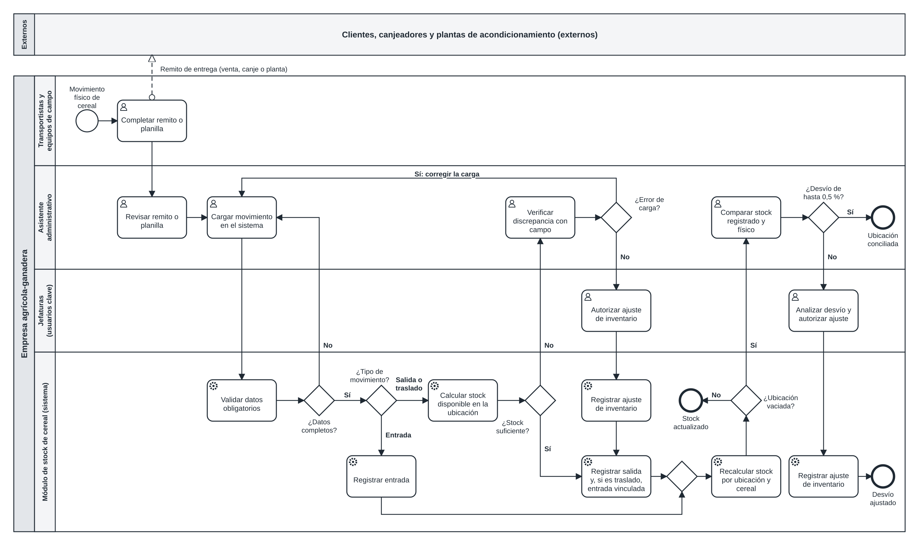

# Proceso BPMN: registro y control de movimientos de cereal

Es el proceso que el módulo transforma: lo que pasa desde que el cereal se mueve hasta que el dato queda cargado en el sistema.

Archivos: [modelo BPMN 2.0](bpmn/proceso-movimiento-cereal.bpmn) (se abre en bpmn.io o Camunda Modeler) y [SVG](bpmn/proceso-movimiento-cereal.svg).

## Quiénes participan

- **Pool externo:** clientes, canjeadores y plantas de acondicionamiento.
- **Pool de la empresa agrícola-ganadera:** carriles para transportistas y equipos de campo, asistente administrativo, jefaturas y el módulo de stock (la parte automatizada).

## Compuertas

Las compuertas exclusivas van sin la X adentro, con la pregunta al lado, como se usa en la cátedra.

| Compuerta | Resultado | Qué se hace |
|---|---|---|
| ¿Datos completos? | No | Vuelve a la carga |
| ¿Tipo de movimiento? | Entrada / Salida o traslado | La entrada se registra directamente; el resto controla el stock |
| ¿Stock suficiente? | No | El asistente verifica la diferencia con campo |
| ¿Error de carga? | Sí / No | Se corrige la carga, o una jefatura autoriza un ajuste |
| ¿Ubicación vaciada? | Sí | Se compara el stock registrado con el físico |
| ¿Desvío de hasta 0,5 %? | No | Una jefatura analiza y autoriza un ajuste |
